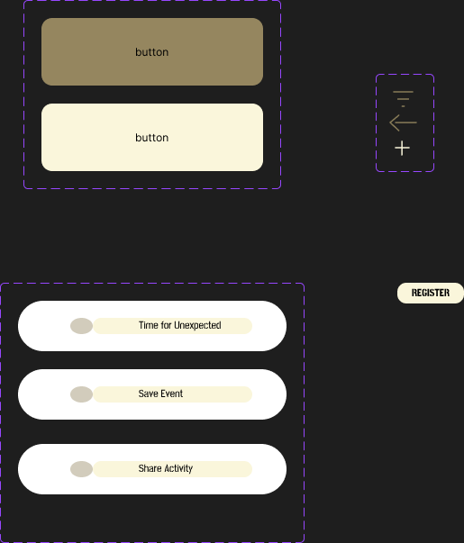

# Prompt: Luxury Bag Finder

Build a one-page website about **luxury handbags**, using HTML, CSS and
JavaScript without frameworks. Put all files in the folder I tell you to work in.

## Data

- Load the handbags from a JSON file called `items.json` in the same folder.
- There are 8 handbags. Each one has: `id`, `name`, `brand`, `year`,
  `country`, `material`, `image`, `alt` and `description`.
- Images are in the `Json-images/` folder.

## Style

Use the colours and type from screenshots below.

Colours:
- Dark brown: #95865F
- Light brown: #FAF6DB
- Dark blue: #1571B3
- Light blue: #C7F7EF
- Fucsia: #B31545
- Pink: #FFCCD5
- Dark pink: #856A75

Type:
- Headings font: Post No Bills Jaffna ExtraBold
- Body font: Inter
- H1: 32 px, H2: 24 px, H3: 20 px, body text: 16 px

Buttons have rounded corners, like in the style guide.

## Page structure

The page has:

- A **header** with a skip link ("Skip to main content") and a **nav** with
  links to the three sections: Search, Details, Sign up.
- A **main** with the three sections below.
- A **footer** with the text "Luxury Bag Finder – Student project".
- Only one **h1** ("Luxury Bag Finder") and no skipped heading levels.

## Section 1: Search and results

- A search field labelled **"Search"**. Typing filters the handbags by name
  or brand.
- Show each result as a card with:
  - a heading with the handbag's name,
  - the brand,
  - its image,
  - an icon-only save button (a heart icon) named **"Save [handbag name]"**,
    for example "Save Birkin".
- Show the number of results (for example "8 results"), and have it read
  out by screen readers when it changes.

## Section 2: Details dialog

- Clicking a result opens a dialog with more about the handbag: name,
  brand, image, year, country, material and description.
- When the dialog opens, focus moves into it.
- Escape and a **"Close"** button close the dialog.
- When the dialog closes, focus goes back to the result that opened it.

## Section 3: Sign-up form

Heading: "Sign up for handbag news". The form has:

- **Name** (text field)
- **Email** (email field)
- **Favourite style** (radio buttons: Tote, Top handle, Shoulder bag, Clutch)
- **Consent** checkbox: "I agree to receive emails"
- A **"Sign up"** button

Errors appear as text next to the field, only after the user has tried to
submit. When the form is sent without errors, show a success message:
"Thanks! You are signed up."

## Main task

A user must be able to: search for Birkin, open its details, close them,
save Birkin and sign up.